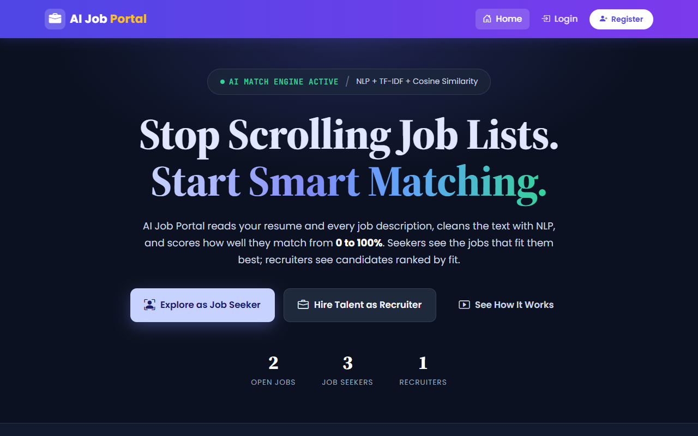
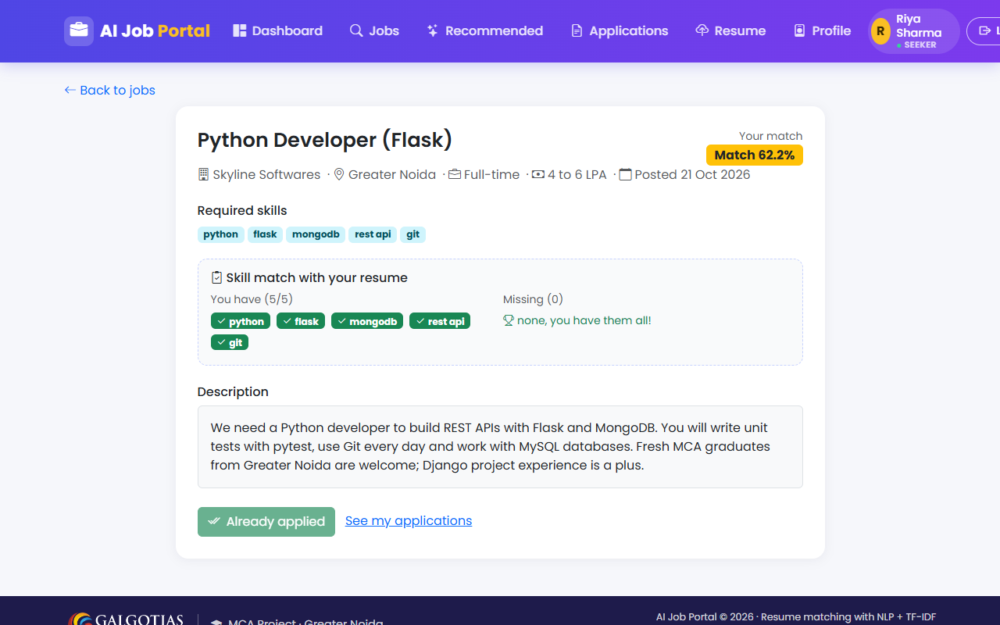
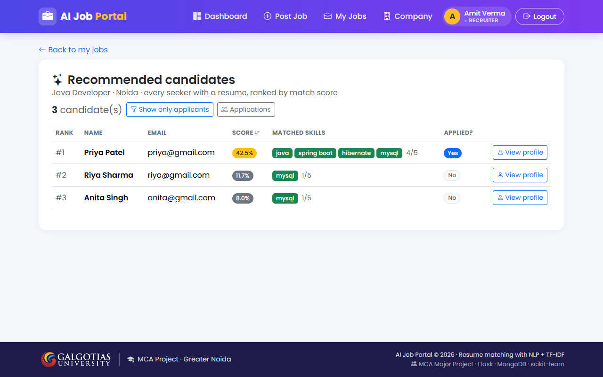

# AI Job Portal

A job portal that reads a candidate's resume and scores how well it matches each job (0 to 100 %), so job seekers see the jobs that fit them and recruiters see candidates ranked by fit.

MCA Major Project, Galgotias University, Greater Noida. Built with Python Flask, MongoDB, NLTK and scikit-learn.

## Screenshots

**Landing page**



**Job details with match score and have / missing skills (seeker)**



**Recommended candidates ranked for a job, including seekers who did not apply (recruiter)**



## Features

**Job seeker**
- Register, login, fill a profile (skills, education, experience)
- Upload a resume (PDF or DOCX); the text and skills are extracted automatically
- Browse and search open jobs; every job shows **Your match %** and the skills you have / are missing
- Apply with one click (the score is saved with the application)
- *Recommended Jobs*: top 5 open jobs ranked by match score
- Track application status (applied / shortlisted / rejected)

**Recruiter**
- Company profile; post, edit and close jobs
- Received applications sorted by match score; shortlist or reject
- *Recommended Candidates*: every seeker with a resume, ranked for a job (even those who did not apply)
- Candidate page with resume text and resume download

**Admin**
- Dashboard with live counts (users, seekers, recruiters, jobs, applications)
- Manage users (search, role filter, delete with cascade), recruiters, jobs and applications

## Tech stack

| Layer | Technology |
|---|---|
| Frontend | HTML, Bootstrap 5, Bootstrap Icons, Jinja2 templates |
| Backend | Python 3, Flask (blueprints, sessions) |
| Database | MongoDB (PyMongo), 6 collections |
| Resume parsing | PyMuPDF (PDF), python-docx (DOCX) |
| NLP | NLTK (stopwords, WordNet lemmatizer), regex skill extraction with `ai/skills.txt` |
| Matching | scikit-learn `TfidfVectorizer` + cosine similarity |
| Tests | pytest |

## How the AI works

1. **Parse.** When a seeker uploads a resume, `ai/parser.py` pulls the raw text out of the file: PyMuPDF reads the text layer of a PDF page by page, python-docx reads the paragraphs and tables of a DOCX. A scanned PDF has no text layer, so it is rejected.
2. **Clean.** `clean_text()` in `ai/nlp.py` lowercases the text, protects symbols that matter (`c++` becomes `cplusplus`, `node.js` becomes `nodejs`), removes everything that is not a letter, drops English stopwords (the, and, of, ...) and lemmatises the remaining words (`projects` becomes `project`). The job's title, description and skills go through the same function, so both sides use the same word forms.
3. **Extract skills.** `extract_skills()` looks for each of the 200 names in `ai/skills.txt` as a whole word in the text, longest names first ("spring boot" before "spring"). The matched skills are stored with the resume.
4. **Vectorise (TF-IDF).** `ai/matcher.py` turns the cleaned resume and the cleaned job into two number vectors with scikit-learn's `TfidfVectorizer`: one column per word, where TF counts how often the word appears in that document and IDF gives rare words (mongodb) more weight than common ones (work, experience).
5. **Compare (cosine similarity).** The similarity is the cosine of the angle between the two vectors: identical text gives 1.0, text with nothing in common gives 0. Multiplied by 100 this is the *text score*. Worked example with a 5-word vocabulary (python, flask, mongodb, git, pytest): resume = `[1, 1, 1, 1, 1]`, job = `[1, 1, 1, 0, 0]`, dot product = 3, lengths = √5 × √3 = 2.236 × 1.732, cosine = 3 / 3.873 = 0.775, text score 77.5. Cosine ignores document length, so a one-page and a three-page resume with the same skills score the same.
6. **Final score = 70 % text + 30 % skill overlap.** Skill overlap is the fraction of the job's required skills that were found in the resume. Pure TF-IDF alone under-scores a good match because a job description contains many words that are not skills: for the demo Python resume against the *Python Developer* job the text score is only 29.9 even though all 5 required skills are present; with 100 % overlap the final score becomes `0.7 × 29.9 + 0.3 × 100 = 50.9`.
7. **Recommendations** are this score in a loop: a seeker's resume is scored against every open job and the top 5 are shown; a job is scored against every resume and the candidates are listed best first. Nothing is pre-computed; every page is calculated on request, and the same resume-job pair gives the same number on every page.

Score quality check (Day 9, three DOCX resumes against three jobs, the diagonal is the best match in every row):

| Resume \ Job | Python Developer | Java Developer | Data Analyst Intern |
|---|---|---|---|
| Python resume (Rahul) | **54.9** | 22.9 | 14.4 |
| Java resume (Priya) | 7.5 | **41.6** | 7.9 |
| Data Analyst resume (Anita) | 14.5 | 9.0 | **62.4** |

## Setup

```
git clone https://github.com/Ayush-kumar57/ai-job-portal.git
cd ai-job-portal
python -m venv venv
venv\Scripts\activate              # Windows
pip install -r requirements.txt
python -c "import nltk; nltk.download('stopwords'); nltk.download('wordnet')"
```

Start MongoDB locally (default `mongodb://localhost:27017`, database `job_portal`), then:

```
cd backend
python create_admin.py             # once: creates the admin account
flask --app app run --debug
```

Open http://127.0.0.1:5000. Run the tests from the project folder with `python -m pytest tests/`.

These steps were verified on 21 Oct 2026 with a fresh clone into an empty folder and a new virtual environment (test 27 in `docs/test_report.md`). Python 3.14 was used; 3.11 or newer should work.

Sample resumes for trying the upload are in `ai/sample_resumes/` (`rahul_python.pdf`, `priya_java.docx`, `anita_analyst.docx`, and `scanned_resume.pdf` to see the rejection message).

## Folder structure

```
ai-job-portal/
├── backend/            Flask app: app.py, config.py, db.py, utils.py, auth/ seeker/ recruiter/ admin/ blueprints, recommend.py
├── frontend/           templates/ (Jinja2) and static/ (css, js, img)
├── ai/                 parser.py, nlp.py, matcher.py, recommend.py, skills.txt, sample_resumes/
├── tests/              pytest tests for the matcher and the recommender (11 tests)
├── docs/               screenshots, db_schema.md, routes.md, test_report.md, demo_script.md
├── uploads/resumes/    uploaded resume files (not committed)
└── requirements.txt
```

More documentation:

- [docs/db_schema.md](docs/db_schema.md): the six MongoDB collections, fields and indexes
- [docs/routes.md](docs/routes.md): every URL, its function, role and what it does
- [docs/test_report.md](docs/test_report.md): the 27-row acceptance test, all passed
- [docs/demo_script.md](docs/demo_script.md): 5-minute demo script and viva answers

## Default admin login

`admin@portal.com` / `admin123` (change it in `backend/create_admin.py` before deploying).

## Team

Solo project: one student covered all three roles of the 10-day plan.

| Name | Role | Built |
|---|---|---|
| Ayush Kumar | Frontend | `frontend/`: Jinja2 templates (landing, auth, seeker, recruiter, admin pages), Bootstrap styling, navbar by role, score / role / status badges |
| Ayush Kumar | Backend | `backend/`: Flask app and blueprints (auth, seeker, jobs, recruiter, admin), MongoDB collections and indexes, sessions and role checks, resume upload/download, cascade delete, tests |
| Ayush Kumar | AI | `ai/`: resume parser (PDF/DOCX), `clean_text` and `extract_skills` (NLTK + `skills.txt`), TF-IDF + cosine matcher with the 70/30 final score, job and candidate recommenders |

Guide: _to fill_. MCA, Galgotias University, Greater Noida, 2026.

## Known limitations and future scope

Limitations

- Matching is keyword based (TF-IDF); it does not understand synonyms or meaning: "ML" and "machine learning" are different words unless both are listed in `ai/skills.txt`.
- Skills are recognised only if they appear in `ai/skills.txt` (about 200 names).
- Scanned (image) resumes have no text layer and are rejected.
- Only English resumes; the stopword list and lemmatizer are English.
- No email notifications, no password reset (the Forgot password page is static), no interview scheduling.
- Single-server deployment with a local MongoDB and local file storage for resumes.

Future scope

- Sentence-BERT (or another sentence-embedding model) so that meaning, not only words, is compared.
- OCR (Tesseract) for scanned resumes.
- Email notifications when an application is shortlisted, and password reset by email.
- Interview scheduling between recruiter and candidate.
- MongoDB Atlas and a cloud host (Render / Railway) with resumes in object storage.
